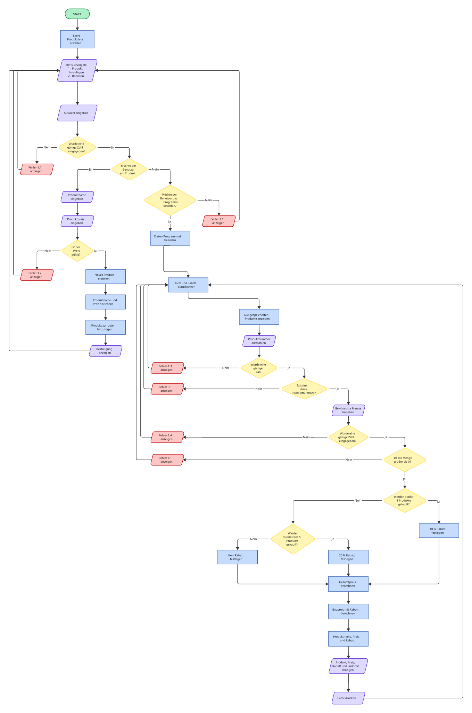

# Mensa Produktrechner

[English](README.md) | [Deutsch](README.de.md)

Eine einfache C#-Konsolenanwendung zur Verwaltung von Produkten und zur Berechnung von Einkaufspreisen mit automatischen Mengenrabatten.

## Über das Projekt

Dieses Projekt wurde im Rahmen einer C#-Programmierübung entwickelt.

Die Anwendung ermöglicht es dem Benutzer:
- Produkte mit Name und Preis hinzuzufügen.
- Alle verfügbaren Produkte anzuzeigen.
- Ein Produkt anhand seiner Nummer auszuwählen.
- Die gewünschte Menge einzugeben.
- Rabatte automatisch berechnen zu lassen.
- Den endgültigen Preis in CHF anzuzeigen.

## Rabattsystem

| Menge | Rabatt |
|---|---:|
| 1–2 Produkte | 0 % |
| 3–4 Produkte | 10 % |
| 5 oder mehr Produkte | 20 % |

## Verwendete Technologien

- C#
- .NET
- Visual Studio

## Projektstruktur

```text
Mensa/
├── Program.cs
└── Product.cs

Documentation/
├── PAP.svg
└── PAP.mmd
```

## Programmablaufplan (PAP)

Das folgende Diagramm zeigt den vollständigen Ablauf und die Logik des Programms.



## Installation und Ausführung

1. Dieses Repository klonen.
2. Das Projekt in Visual Studio öffnen.
3. Das Projekt kompilieren.
4. Die Anwendung starten.
5. Den Anweisungen in der Konsole folgen.

## Autor

Erstellt als C#-Lernprojekt.
