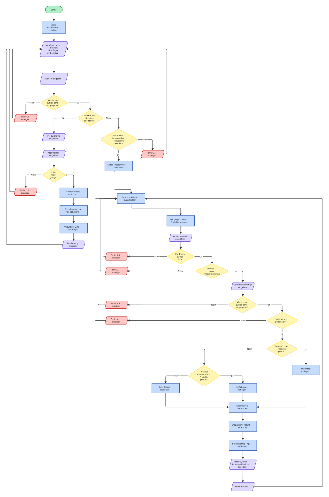

# Mensa Product Calculator

[English](README.md) | [Deutsch](README.de.md)

A simple C# console application for managing products and calculating purchase prices with automatic quantity-based discounts.

## About the Project

This project was developed as a C# programming exercise.

The application allows users to:
- Add products with a name and price.
- Display all available products.
- Select a product by its number.
- Enter the desired quantity.
- Automatically calculate discounts.
- Display the final price in CHF.

## Discount System

| Quantity | Discount |
|---|---:|
| 1–2 products | 0% |
| 3–4 products | 10% |
| 5 or more products | 20% |

## Technologies

- C#
- .NET
- Visual Studio

## Project Structure

```text
Mensa/
├── Program.cs
└── Product.cs

Documentation/
├── PAP.svg
└── PAP.mmd
```

## Program Flowchart (PAP)

The following diagram illustrates the complete program logic.



## How to Run

1. Clone this repository.
2. Open the project in Visual Studio.
3. Build the project.
4. Run the application.
5. Follow the instructions in the console.

## Author

Created as a C# learning project.
